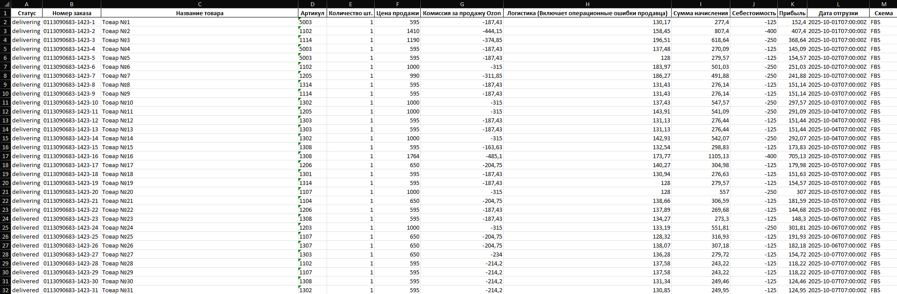

<div align="center">


# OzonReportX

**Бесплатная программа для продавцов Ozon и Wildberries: прибыль, цены, акции, реклама и поставки — в одном окне на вашем компьютере.**

[](https://github.com/Alator2001/OzonReportX/releases/latest)
[](https://github.com/Alator2001/OzonReportX/releases)
[](LICENSE)


### [⬇️ Скачать для Windows и macOS](https://github.com/Alator2001/OzonReportX/releases/latest)

Версия **3.4.0** · без установки Python · данные не покидают ваш компьютер

</div>

---

OzonReportX сам загружает данные из кабинета Ozon (и Wildberries) по API, считает **чистую прибыль**,
**юнит-экономику** и **цены** и подсказывает, что поменять. Всё работает локально: ключи и отчёты хранятся
только у вас. Ничего не отправляется в Ozon без вашего подтверждения.

**Зачем, если есть кабинет Ozon и платные сервисы аналитики?**

- 💸 **Видно, сколько вы реально заработали** — выручка минус комиссии, логистика, реклама, хранение и себестоимость, по каждому заказу и за месяц.
- ✅ **Ozon с вами рассчитался?** Сверка выплат показывает, какие месяцы Ozon уже закрыл деньгами, а сколько ещё должен.
- 🏷️ **Акции без потерь** — по каждому товару видно, в каких акциях он окажется при цене и сколько вы с этого заработаете.
- 📦 **Поставки и остатки** — сколько везти на склады Ozon и WB и сколько держать у себя.
- 🔒 **Бесплатно, с открытым кодом и без облака** — вы не отдаёте ключи от кабинета чужому сервису.



## Содержание

- [Что умеет](#что-умеет)
- [Быстрый старт](#быстрый-старт)
- [Подключение кабинетов](#подключение-кабинетов)
- [Себестоимость: costs.xlsx](#себестоимость-costsxlsx)
- [Разделы программы](#разделы-программы)
- [Где лежат файлы](#где-лежат-файлы)
- [Обновление программы](#обновление-программы)
- [Перенос на другой компьютер](#перенос-на-другой-компьютер)
- [Частые вопросы](#частые-вопросы)
- [Безопасность](#безопасность)
- [Для разработчиков](#для-разработчиков)

## Что умеет

| | |
|---|---|
| 📊 **Бизнес-сводка** | Месячный отчёт: выручка, чистая прибыль, рентабельность, комиссии, логистика, реклама, хранение, сверка с выплатами Ozon. График по месяцам |
| 💰 **Цены** | Минимальная и желательная цена по вашей марже, текущая рентабельность каждого товара, минимальные цены в Ozon, заявки покупателей на скидку |
| 🏷️ **Акции** | Календарь акций, вывод невыгодных товаров, добавление выгодных, порядок в предстоящих акциях, управление автодобавлением |
| 📣 **Реклама** | Подбор ставок «Оплата за клик» по экономике товара: сколько можно платить за клик, чтобы реклама окупалась |
| 🔎 **Анализ** | Почему товар продаётся или не продаётся без рекламы: наличие, цена и индекс цен, карточка, воронка, сезонность |
| 📦 **Поставки** | План поставки FBO по складам и кластерам с учётом сезонности и запаса на своём складе |
| 🏬 **Остатки** | Одна таблица на Ozon и WB: остатки FBS, FBO, FBW и сколько держать на каждом складе на ближайшие 30 дней |
| 🧮 **ABC/XYZ** | Какие товары приносят прибыль и насколько стабилен их спрос |
| 🤖 **AI-ассистент** | Вопросы о прибыли и рисках простым языком — локальная модель, данные никуда не уходят |
| 🟣 **Wildberries** | Финансовая сводка по отчётам WB и план запасов |

## Быстрый старт

### Готовое приложение (проще всего)

1. **Скачайте архив** со страницы [последнего релиза](https://github.com/Alator2001/OzonReportX/releases/latest):
   `OzonReportX-…-Windows.zip`, `OzonReportX-…-macOS-arm64.zip` (Mac на Apple M1–M4) или `…-macOS-x86_64.zip` (Mac на Intel).
   Python и библиотеки ставить не нужно — всё внутри.
2. **Windows:** распакуйте архив в любую папку и запустите `OzonReportX.exe`. Если Windows покажет
   «Система Windows защитила ваш компьютер», нажмите «Подробнее» → «Выполнить в любом случае».
   **macOS:** распакуйте и перенесите `OzonReportX.app` в «Программы». При первом запуске щёлкните по нему
   правой кнопкой → «Открыть» → «Открыть»: приложение не подписано сертификатом Apple, и иначе macOS его не откроет.
3. Дальше — с шага 4 ниже. Отчёты, `costs.xlsx`, ключи и настройки приложение хранит в папке
   **«Документы/OzonReportX»**; при установке новой версии поверх старой они сохраняются. Другую папку можно выбрать
   в **«Настройки» → «Папка с данными»** — например, ту, где уже лежат ваши отчёты (действует после перезапуска).

> Уже пользуетесь версией из исходников? Выберите её папку в «Настройки» → «Папка с данными» — приложение будет
> работать с теми же отчётами и ключами. Только не запускайте обе версии одновременно.

### Из исходников

1. **Установите Python 3.14** с [python.org](https://www.python.org/downloads/).
   На Windows при установке отметьте **Add python.exe to PATH**.
   На macOS можно поставить через Homebrew: `brew install python@3.14`.
2. **Скачайте программу** — архивом с GitHub или командой `git clone`.
3. **Запустите `OzonReportX_UI.bat`** (Windows) или **`OzonReportX_UI.command`** (macOS, двойной клик в Finder).
   При первом запуске программа сама создаст окружение и установит
   нужные библиотеки (это займёт несколько минут), затем откроет окно и мастер подключения.
4. **Подключите кабинет Ozon** в мастере (см. [ниже](#подключение-кабинетов)).
5. **Заполните `costs.xlsx`** — артикулы и себестоимость (см. [ниже](#себестоимость-costsxlsx)).
6. Откройте **«Бизнес-сводка»**, выберите месяц и нажмите **«Сформировать отчёт»**.

> Дальше программа запускается тем же `OzonReportX_UI.bat` / `OzonReportX_UI.command`.
> `OzonReportX.bat` / `OzonReportX.command` — старое консольное меню: в нём нет новых разделов, им пользоваться не нужно.

Боковое меню с разделами можно свернуть до колонки иконок кнопкой ☰ рядом с кнопкой темы — на маленьком
экране так больше места для таблиц. Программа запоминает выбор.

Тема оформления (светлая или тёмная) выбирается автоматически по настройке системы и меняется вместе с ней.
Кнопка темы в левом верхнем углу переключает её вручную до закрытия программы.

<details>
<summary><b>Особенности macOS</b></summary>

- Если двойной клик по `.command` пишет «нет прав на выполнение», выполните в Терминале в папке программы:
  `chmod +x *.command`.
- Если macOS не даёт открыть файл из скачанного архива, щёлкните по нему правой кнопкой → «Открыть».
- Если папка «Документы» синхронизируется с iCloud, отключите для папки программы «Оптимизировать хранилище»:
  иначе `costs.xlsx` и отчёты могут быть выгружены из локальной копии.
</details>

## Подключение кабинетов

Мастер открывается сам при первом запуске, позже — **«Настройки» → «Настроить подключения»**.
Можно подключить один маркетплейс и вернуться к остальным позже (кнопка «Позже»).

| Что | Где взять | Зачем |
|---|---|---|
| **Ozon Client ID и API-ключ** | Кабинет Ozon → [Настройки → API-ключи](https://seller.ozon.ru/app/settings/api-keys) | Всё, что связано с Ozon. API-ключ показывается один раз — сохраните его сразу |
| **Ozon Performance Client ID и Client Secret** (по желанию) | Кабинет Ozon → Продвижение → API | Расходы на рекламу в отчёте, раздел «Реклама», рекламные данные в «Анализе». Client ID выглядит как `…@advertising.performance.ozon.ru` |
| **Wildberries API-токен** (по желанию) | Кабинет WB → Интеграции по API → Создать токен → Ручная интеграция | Раздел Wildberries. Подойдёт персональный токен «Только чтение»; для сводки включите категорию «Финансы» |

Ключи сохраняются в файл `.env` в папке программы и никуда не отправляются. Пример полей — [.env.example](.env.example).

## Себестоимость: costs.xlsx

`costs.xlsx` в папке программы — справочник ваших товаров. Без него программа не посчитает прибыль и цены.

Создайте файл с листом **«Основной»** и двумя колонками:

| Артикул | Себестоимость |
|---|---|
| 1101 | 420 |
| 1202 | 610 |

- **Артикул** — ваш артикул товара в Ozon (`offer_id`).
- **Себестоимость** — сколько стоит вам одна штука, в рублях.

Остальные колонки программа допишет сама: минимальная и желательная цена, текущая цена в Ozon,
рентабельность, ожидаемая прибыль, а на листе «Акции» — цены и бустинг в каждой акции.
Себестоимость удобно править прямо в программе: **«Цены и скидки»** → таблица → **«Сохранить изменения»**.

## Разделы программы

### 📊 Бизнес-сводка

Выберите месяц и год → **«Сформировать отчёт»**. Программа загрузит заказы FBS и FBO, начисления Ozon,
расходы на рекламу, хранение и звёздные товары и сохранит отчёт в `reports/<Месяц> <Год>.xlsx`.

- Если рекламный кабинет не подключён, программа спросит сумму на продвижение. Сумму на внешний маркетинг
  она спрашивает всегда. Не было расходов — оставьте 0.
- Загрузка занимает несколько минут: Ozon ограничивает частоту запросов, и программа соблюдает лимит.
- **Важно про возвраты:** Ozon проводит начисления с опозданием. Программа добирает начисления до 21 дня
  после конца месяца. Заказы, по которым начисление ещё не пришло, помечены «ожидает расчёта» и в прибыль
  не входят. Сформируйте отчёт за прошлый месяц повторно через 2–3 недели — цифры станут точнее.
- **«Построить»** — график прибыли, оборота или рентабельности за несколько месяцев. Недостающие отчёты программа
  сформирует сама.
- **Сверка выплат.** После каждого отчёта программа сверяет реальные выплаты Ozon со всеми месячными отчётами:
  выплаты закрывают месяцы по порядку, от старых к новым, сначала себестоимость, потом прибыль. На листе «Заказы»
  в колонках S–U видно, какие выплаты (дата, сумма) закрыли месяц, в W–Y — сколько себестоимости и прибыли закрыто
  и сколько осталось. «Ozon рассчитался за месяц: Да» — обе дельты нулевые. Нужны отчёты за все месяцы с начала магазина.
- **«Настройки» → «Проверить баланс Ozon»** — начисления, выплаты и услуги Ozon за месяц, сравнение с вашим отчётом.

### 💰 Цены и скидки

1. Задайте **минимальную** и **желаемую маржу** в шапке раздела (например, 0.25 и 0.30), сохраните иконкой дискеты
   → **«Рассчитать цены»**. Комиссию и логистику программа берёт из отчёта за прошлый месяц.
2. **«Синхронизировать»** подтягивает текущие цены из Ozon и считает рентабельность каждого товара. Синхронизация
   запускается и сама при входе во вкладку (не чаще раза в 5 минут).
3. **«⋯» → «Обновить минимальные цены в Ozon»** отправляет минимальные цены в карточки: ниже них Ozon не опустит цену
   при автоматических акциях (если включён учёт минимальной цены). В том же меню — открыть `costs.xlsx` и перечитать таблицу.
Над таблицей — итоги: сколько товаров, у скольких цена ниже минимальной, средняя рентабельность и прибыль с единицы.
Артикул и себестоимость правятся прямо в таблице → **«Сохранить изменения»**.

4. **Заявки на скидку** загружаются при входе во вкладку. Программа советует одобрить заявку, если цена не ниже
   вашей минимальной. Решайте по одной или нажмите **«Обработать автоматически»** — тогда все не рекомендованные
   к одобрению заявки будут **отклонены**, в том числе по товарам, которых нет в `costs.xlsx`.

> Цены в программе — **цены продавца**: от них Ozon считает комиссию и вашу выплату. Покупатель видит цену
> за вычетом скидок Ozon — обычно на 30–35% ниже.

### 🏷️ Акции

> ⚠️ С октября 2026 участие в акциях Ozon задаёт **одна предельная цена товара**: товар в акции, пока его цена
> не выше порога акции, и выходит, если выше. Цена одна на все акции сразу, после конца акции сама не возвращается.

- **Предельная цена** — ползунок по каждому артикулу. Зелёный отрезок — между вашей минимальной и желательной
  ценой, цветные — до какой цены товар участвует в каждой акции. Двигайте ползунок: сразу видно, в каких акциях
  будет товар, какой бустинг и откуда он **войдёт** или **выйдет**.
  Крупно видно цену, **прибыль с продажи** и **эффект акций** — наибольший бустинг из акций (как в кабинете Ozon,
  бустинги не складываются) плюс 30% за распродажу («Чёрная пятница», «11.11»), — и те же цифры при текущей цене.
  **«Подобрать баланс»** (и **«Лучший баланс»** у каждого артикула) ищет цену между минимальной и желательной, при
  которой больше всего прибыли за период: прибыль с продажи × продажи, а продажи растут от бустинга и от более низкой
  цены. Насколько покупатели реагируют на цену — выберите в «Реакция покупателей на цену» (по умолчанию средняя). **«Применить в Ozon»** показывает итог по каждому артикулу и только после
  подтверждения отправляет цены; затем участие перечитывается из Ozon.
  Акции, которые ещё не начались, — отдельное участие «с даты» со своей ценой: ползунок его не меняет, а если цена
  там ниже минимальной, программа предупредит.
- **Календарь акций** — даты, бустинг, ваши участники и цены в каждой акции.
- **Автодобавление** — выключить или включить автодобавление Ozon в акции, включить учёт минимальной цены
  и продлить его таймер. Программа ведёт журнал и предупредит, если Ozon включит автодобавление обратно.

Всё отправляется только кнопкой **«Отправить в Ozon»**. После отправки программа проверяет по данным Ozon,
что изменение применилось, и показывает, что не прошло и почему.

### 📣 Реклама

Нужен рекламный кабинет (Performance API). Выберите кампанию → **«Подобрать ставки»**. Программа для каждого
товара объясняет шаг за шагом: прибыль с продажи, наличие, стадию теста, воронку, окупаемость и предлагает ставку.
Ставка меняется не больше чем на 25% за раз и не ниже минимальной ставки Ozon. **«Применить отмеченные»**
отправляет ставки и проверяет, что Ozon их принял. Работает в стратегии «Средняя стоимость клика».

Прибыль товара берётся из `costs.xlsx`: перед подбором ставок синхронизируйте цены.

### 🔎 Анализ

Выберите период (7, 14, 28 или 56 дней) → **«Начать анализ»**. Для каждого товара — органические продажи
(всё, кроме рекламы) по сравнению с прошлым периодом и с той же порой год назад, разбор причин и рекомендации
по важности. Программа копит свою историю цен, остатков и рейтинга, чтобы показать, что менялось перед падением.
Позиции в поиске видны только с подпиской Ozon Premium.

### 🔍 Поиск

По каким запросам покупатели находят ваши товары и чего не хватает карточкам. Данные программа загружает сама,
раз в день при запуске, и копит свою историю: без подписки Premium Ozon хранит её только месяц.
Ozon отдаёт данные за день с задержкой в 2 дня. Кнопка **«Обновить данные»** загружает их сразу.

- **Обзор** — спрос в поиске, заказы и конверсия за неделю к прошлой, список «Что сделать в первую очередь»:
  что упало — спрос или конверсия, товары, которые ищут, но не заказывают, частые запросы, слов которых нет
  в названиях, растущие запросы. Нажмите на артикул — откроется товар.
- **Запросы** — семантическое ядро: запросы склеены по смыслу в кластеры, видно спрос, тренд недели и у скольких
  товаров слова кластера есть в названии. Звёздочкой ★ отмечаются целевые запросы — парсер позиций замеряет их первыми.
- **Товары** — по каждому товару: спрос, заказы, какая доля спроса покрыта названием, пробелы в карточке,
  матрица «кластер × название / описание / характеристики», главные запросы и история изменений карточки.
- **Позиции** — позиции в выдаче по регионам, когда включён парсер (ниже).

Свои запросы и CSV добавляются командой: `.venv/bin/python scripts/search_semantics.py add "доска из кедра" --offer 1302`
или `… import запросы.csv` (колонки «запрос», «артикул», «частотность», «приоритет»).

**Позиции в выдаче по регионам** (без подписки Ozon их не отдаёт) замеряет отдельный парсер. По умолчанию он выключен:

1. Установите браузер для парсера (один раз, около 150 МБ): `.venv/bin/python scripts/serp_profile.py setup`.
2. Создайте профиль каждого региона — откроется окно Ozon, выберите в шапке город и нажмите Enter в терминале:
   `.venv/bin/python scripts/serp_profile.py create msk "Москва"` и
   `.venv/bin/python scripts/serp_profile.py create spb "Санкт-Петербург"`.
3. Добавьте в `.env` строку `SERP_PARSER_ENABLED=1`.

Дальше приложение раз в день замеряет до 15 запросов в каждом регионе с паузами (20–30 минут в фоне).
Если Ozon покажет капчу, замеры остановятся на сутки — программа не пытается её обойти.
Проверить, что будет замерено: `.venv/bin/python scripts/serp_collect.py --dry-run`.
На Windows вместо `.venv/bin/python` — `.venv\Scripts\python.exe`.

### 📦 Поставки

Укажите **срок поставки**, **цикл** (на сколько дней продаж должно хватить) и **уровень сервиса** (вероятность
не уйти в ноль: 0.8 — меньше товара, 0.95 — больше) → **«Рассчитать поставку»**. Результат — сколько штук каждого
артикула везти на каждый склад FBO и сколько держать на своём складе:
`stocks reports/Поставка FBO <дата>.xlsx`. На листе «Как считается» расчёт показан с вашими цифрами.

Первый расчёт загружает историю заказов за два года и идёт дольше; потом закрытые месяцы берутся из кэша.

### 🏬 Остатки

Одна таблица на Ozon и Wildberries: остатки на своём складе (**FBS**), на складах Ozon (**FBO**) и WB (**FBW**)
и сколько **нужно держать** на каждом, чтобы хватило на ближайшие 30 дней. Считается так же, как в «Поставках»
(сезонность, доля артикула, уровень сервиса), только с сегодняшнего дня. Красным — не хватает или склад пуст там,
где товар нужен. Над таблицей видно, откуда взялся прогноз каждого магазина. Данные обновляются кнопкой **«Обновить»**;
ничего в Ozon и WB не отправляется.

### 🧮 ABC/XYZ-анализ

**«Новый анализ»** → выберите период → **«Провести анализ»**. Анализ строится по месячным отчётам
(недостающие программа сформирует сама).
**A/B/C** — вклад в прибыль (A — 80% прибыли), **X/Y/Z** — стабильность спроса.
Матрица на экране показывает, какие товары — опора бизнеса, а какие — кандидаты на вывод.

### 🤖 AI-ассистент

Задайте вопрос своими словами — «Как дела в магазине?», «Что срочно пополнить и сколько это стоит?»,
«Почему упали продажи артикула 1102?», «Какие товары класса A без остатка?». Ассистент сам соберёт нужные данные:
месячные отчёты Ozon и Wildberries, цены и себестоимость, акции, ABC/XYZ, планы поставки, анализ органики, поиск,
а если нужно — текущие цены, остатки и акции прямо из Ozon (только просмотр, ничего не меняет).
Нужна бесплатная программа [Ollama](https://ollama.com/download) и модель с поддержкой инструментов:
`ollama pull qwen3.5:9b` (лучше, нужно ~10 ГБ свободной памяти) или `ollama pull qwen3:4b` (быстрее, слабее).
Модель выбирается в списке на вкладке ассистента; по умолчанию — из `.env` (`OLLAMA_MODEL`, `OLLAMA_HOST`).
Ответ на сложный вопрос занимает 1–5 минут.

### 🟣 Wildberries

Переключите магазин на Wildberries в левой колонке.

- **Бизнес-сводка** — выберите месяц → **«Загрузить из WB»**. WB разрешает один финансовый запрос в минуту,
  загрузка занимает несколько минут. **«Себестоимость WB»** открывает `wb_costs.xlsx`: заполните себестоимость
  по nmId и нажмите **«Пересчитать из файлов»**. Пока себестоимость не заполнена, прибыль не показывается.
- **Поставки** — **«Рассчитать для WB»**: сколько везти на склады WB и сколько держать на своём складе.
  План считается только по данным WB и с планом Ozon не смешивается.

## Где лежат файлы

Все файлы — в папке программы. Быстро открыть их можно в разделе **«Файлы»**.

| Папка / файл | Что внутри |
|---|---|
| `reports/` | Месячные отчёты Ozon (`Сентябрь 2026.xlsx`) и WB (`WB Сентябрь 2026.xlsx`) |
| `ABC&XYZ reports/` | Отчёты ABC/XYZ |
| `stocks reports/` | Планы поставок FBO и WB |
| `balance reports/` | Выгрузки баланса |
| `costs.xlsx`, `wb_costs.xlsx` | Себестоимость и цены Ozon / себестоимость WB |
| `search data/` | Поиск и ключевые слова: база запросов и позиций, профили регионов для парсера |
| `.env` | Ключи API |

Если отчёт открыт в Excel, программа не сможет его перезаписать — закройте файл и повторите.
При сбое загрузки прежний отчёт не портится: новый файл записывается только целиком.

## Обновление программы

**«Настройки» → «Проверить обновления»** показывает, есть ли новая версия и что в ней изменилось.

- **Готовое приложение:** «Скачать обновление» открывает страницу новой версии — скачайте архив и замените
  старое приложение новым. Данные лежат отдельно, в папке с данными, и сохраняются.
- **Версия из исходников:** «Установить обновление» делает резервную копию рядом с папкой программы, ставит новую
  версию и сохраняет все ваши данные: ключи, себестоимость, отчёты, настройки. После установки перезапустите программу.

## Перенос на другой компьютер

1. На старом компьютере запустите **`Export_Data.bat`** (на macOS — `Export_Data.command`) — появится архив `OzonReportX_transfer_<дата>.zip`
   с ключами, себестоимостью, настройкой маржи и отчётами. На macOS архив сразу откроется в Finder.
2. На новом компьютере установите Python 3.14, скачайте программу и положите архив в её папку.
3. Запустите **`Import_Data.bat`** (или перетащите архив на него), затем `OzonReportX_UI.bat`.

На macOS запустите **`Import_Data.command`**, затем `OzonReportX_UI.command`. Архив можно не переносить
в папку программы: импорт сам найдёт самый свежий `OzonReportX_transfer_*` в папке программы или в «Загрузках»,
а если не найдёт — предложит выбрать файл. Перед импортом он покажет, какой архив будет загружен, и спросит подтверждение.
Подходит и архив, сделанный на Windows, и папка, в которую Safari сам распаковал архив при скачивании.

> В архиве ключи API — не пересылайте его открыто и удалите после переноса.
> Настройки поставок и рекламы в архив не входят — задайте их заново.

## Частые вопросы

<details>
<summary><b>Окно не открывается или закрывается сразу</b></summary>

Проверьте, что установлен Python 3.14 и при установке отмечено «Add python.exe to PATH». Запустите
`OzonReportX_UI.bat` ещё раз — текст ошибки останется в окне консоли. На macOS текст ошибки
останется в окне Терминала, открытом `OzonReportX_UI.command`.
</details>

<details>
<summary><b>«Ozon ограничил частоту запросов (429)»</b></summary>

Программа сама делает паузы и повторяет запрос. Если ошибка не проходит, подождите несколько минут.
Если она повторяется постоянно по одному и тому же методу, скорее всего, Ozon выводит этот метод из работы —
проверьте обновления программы.
</details>

<details>
<summary><b>Ошибка 401 или 403</b></summary>

Проверьте Client ID и API-ключ в «Настройках» (без лишних пробелов) и что ключ не удалён в кабинете Ozon.
Для WB — что у токена включена нужная категория (для сводки — «Финансы»).
</details>

<details>
<summary><b>Нет цен или «Файл costs.xlsx не найден»</b></summary>

Создайте `costs.xlsx` с листом «Основной» и колонками «Артикул» и «Себестоимость»
([как](#себестоимость-costsxlsx)). Цены считаются по отчёту за прошлый месяц: если его нет, программа
сформирует его сама.
</details>

<details>
<summary><b>Прибыль в отчёте отличается от выплаты Ozon</b></summary>

Ozon считает начисления по дням проводок, а отчёт — по заказам месяца. Небольшое расхождение нормально,
отчёт показывает его отдельной строкой. Большое обычно из-за заказов «ожидает расчёта» — сформируйте отчёт
повторно позже.
</details>

<details>
<summary><b>Нет листа «Кампании» и расходов на рекламу</b></summary>

Подключите рекламный кабинет: Ozon Performance Client ID (вида `…@advertising.performance.ozon.ru`) и Client Secret.
</details>

## Безопасность

- Ключи хранятся только в `.env` на вашем компьютере и исключены из Git. Не публикуйте `.env` и архив переноса.
- Цены, акции, ставки и заявки отправляются в Ozon **только после вашего подтверждения**, и программа проверяет,
  что изменение применилось.
- Wildberries подключается только на чтение.

## Для разработчиков

Устройство программы, расчёты, работа с API и известные ограничения — в
**[документации для разработчиков](docs/dev/README.md)**. Тесты:

```bash
.venv/Scripts/python.exe -m unittest discover -s tests   # Windows
.venv/bin/python -m unittest discover -s tests           # macOS
```

Сборка приложения — `packaging/build.py` (подробнее в [docs/dev/18-packaging.md](docs/dev/18-packaging.md)).
Сборки для macOS и Windows прикладываются к релизу автоматически (`.github/workflows/build.yml`).

## Участие и лицензия

Нашли ошибку или не хватает функции — [создайте issue](https://github.com/Alator2001/OzonReportX/issues/new/choose).
Как предложить изменения в коде — в [CONTRIBUTING.md](CONTRIBUTING.md). Если программа помогает вам —
поставьте ⭐ репозиторию: так её проще найти другим продавцам.

OzonReportX распространяется по лицензии [GNU GPL v3](LICENSE): пользоваться, изучать и менять можно свободно;
распространяя изменённую версию, нужно открыть её код под той же лицензией.
